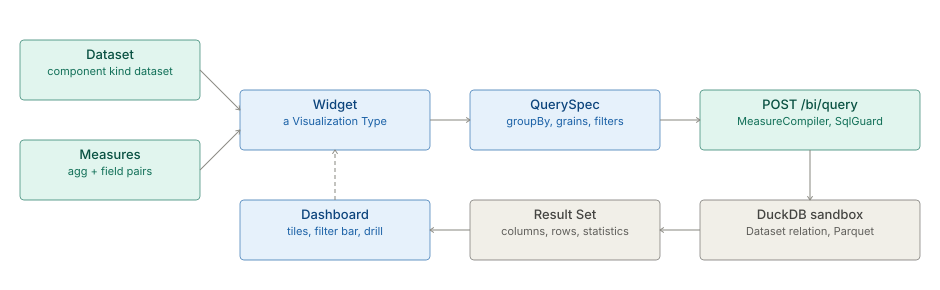

# Studio BI

> **Level 3 module page** (`SOLUTION-SUITE-DOCS-1`). Layer: Platform base.
> Offering: all tiers (the BI half is ungated); the two investigation studios are Professional and
> above and have their own page, [link-analysis](link-analysis.md). Checked against the code on 2026-10-17.

## 1. What it is

Studio is where a builder turns a **Dataset** into something a person can read: a number, a table, a
chart, a board. Its parts, in the canonical vocabulary:

- **Dataset** — a named relation over a store (component kind `dataset`), owned by the data plane.
- **Measure** — an aggregation over a Dataset field (`{agg, field}`), or a named calculated Measure
  stored on the Dataset.
- **Visualization Type** — a template for a chart or view (`VizPlugin`); thirteen ship.
- **Widget** — an instance: one Visualization Type bound to a Dataset with its controls set.
- **Dashboard** — tiles of Widgets with a quick-filter bar, drill-through and PNG export.
- **KPIs and Reports** — the business gallery, with scheduled delivery through the `report` Job Type.

The capability spec of record is [studio](../../okf/capabilities/studio/studio.md); Datasets and the guarded SQL stack
are in [data-plane](../../okf/capabilities/data-plane/data-plane.md).

## 2. Who uses it

- **Analysts and builders** define Datasets and Measures, build Widgets and Dashboards.
- **Business users** read Dashboards and the KPI and Reports page (the business lens home).
- **External viewers** open a shared Dashboard through a public embed link.

## 3. Where it sits

Studio reads committed stores from [storage](storage.md) through Datasets; it writes nothing to
business data. Widgets, Dashboards and Datasets are ordinary component kinds, so they get versions,
ETags and history from the component registry. Code homes:

- Server: `inspecto/src/main/java/com/gamma/control/BiRoutes.java`,
  `platform/inspecto-engine/src/main/java/com/gamma/query/MeasureCompiler.java`,
  `inspecto/src/main/java/com/gamma/control/ShareRoutes.java`.
- SPA: `inspecto-ui/src/app/modules/admin/studio/` (shell `studio.routes.ts`) and the Visualization
  Type registry in `inspecto-ui/src/app/inspecto/viz/` (`viz-types.ts`, `viz-registry.ts`,
  `plugins/index.ts`, `query-spec.ts`).

## 4. How it works

**Visualization Types.** A `VizPlugin` declares `meta`, `controls`, `buildQuery()`,
`transformProps()` and a `render` descriptor. `BUILTIN_VIZ_PLUGINS` registers, in order: `kpi`,
`table`, `bar`, `line`, `area`, `pie`, `bubble`, `gauge`, `scatter`, `funnel`, and the view-bound
`geo-map`, `link-analysis` and `reconciliation`. `viz-render.component.ts` dispatches on
`render.kind` (`chartjs`, `aggrid`, `component`).

**Controls become structured Measures, never SQL text.** A control value
(`{field, agg, grain, expression}`) is turned into a `QueryMeasure` `{agg, field}` by
`query-spec.ts`. The Widget produces a `QuerySpec`
(`{datasetId, sourceName, groupBy, grains?, measures, filters?, orderBy?, limit?}`); a spec that
cannot cross faithfully fails rather than degrading.

**The result path.** `POST /bi/query` hands the spec to `MeasureCompiler`, which builds one SELECT
from validated identifiers and typed literals: fifteen aggregations (`count`, `countDistinct`, `sum`,
`avg`, `min`, `max`, `median`, `stddev`, `variance` and percentiles `p05`…`p99`) and three grains
(`day`, `week`, `month`). The text then passes `SqlGuard.check` (422 on failure), the Dataset resolves
through `DatasetRelation.relationSql`, and it runs in the same ephemeral DuckDB sandbox as
`POST /queries/{id}/run`. The answer is the shared Result Set:
`{resultSet: {columns, rowCount}, rows, statistics{rowCount, elapsedMs, truncated}, sql}`. The public
embed, the `report` Job and the Measure-alert probe reuse this path.

**Dashboards.** A Dashboard config holds `tiles: [{widgetId, span}]`, an optional `filter`,
`exposedFields` for the quick-filter chips, a viewer header (`description`, `asOf`, `illustrative`)
and a viewer-only date range (`dateField`, `defaultRange`).

**Freshness.** The Dataset list shows a badge derived at read time from the newest `dataset.write`
Signal against the `maximumAge` of a freshness Alert Rule; nothing is persisted as "stale".

## 5. Configuration

| Component kind | Key fields |
|---|---|
| `dataset` | `sourceName` (never defaulted), columns, calculated columns, `measures` (named Measures) |
| `widget` | `vizType` (required), the Dataset binding and control values |
| `dashboard` | `tiles`, `filter`, `exposedFields`, `description`, `asOf`, `illustrative`, `dateField`, `defaultRange` |
| `*_job.toon` with `type: report` | scheduled export and delivery |

Specs are declared in `platform/inspecto-config/src/main/java/com/gamma/config/spec/ConfigSpecs.java`.

## 6. Screens

- **Datasets** (`/catalog/datasets`; editor `studio/datasets/dataset-editor.component.ts`, Measures
  tab `dataset-measures.component.ts`). `/studio/datasets` redirects there.
- **Query Library** (`/studio/queries`), **Widgets** (`/studio/widgets`, `widget-host.component.ts`),
  **Dashboards** (`/studio/dashboards`), **Template Gallery** (`/studio/templates`).
- **KPI and Reports** (`/kpi-reports`), a top-level pane, not a Studio child.

## 7. API

| Route | Purpose |
|---|---|
| `POST /bi/query` | compile and run a `QuerySpec` |
| `GET /bi/templates`, `POST /bi/templates/{id}/apply` | curated templates, all-or-nothing apply |
| `/components/dataset`, `/components/widget`, `/components/dashboard` | CRUD, versions, restore |
| `GET /datasets/{id}/rows`, `/datasets/{id}/freshness`, `POST /datasets/{id}/materialize` | Dataset reads |
| `POST /queries/{id}/run` | run a saved Query |
| `POST /dashboards/{id}/share`, `GET /public/dashboards/{token}`, `POST …/query` | public embed |
| `GET /kpis/{id}/value` | one KPI value |

## 8. Interactions

- **Alerts:** Measure-shape Alert Rules and freshness Alert Rules ([alerts](alerts.md)).
- **Jobs:** the `report` Job Type delivers exports on a schedule ([jobs-scheduler](jobs-scheduler.md)).
- **Analytics kernel:** time grains and statistics ([analytics-kernel](analytics-kernel.md)).
- **Exchange:** shared Datasets and Widgets across Spaces ([exchange](exchange.md)).
- **Identity and access:** public routes and HMAC share tokens ([identity-access](identity-access.md)).

## 9. Limits and gotchas

- `GET /bi/datasets` was retired; Datasets are listed through the component registry only.
- A `QuerySpec` with a free-text `expression` cannot cross to `/bi/query`.
- Every row read is a page with `truncated`; a consumer that counts must say so.
- A blank Dashboard header value is not written, so clearing a field removes the key.
- Only three time grains (`day`, `week`, `month`) cross the wire.
