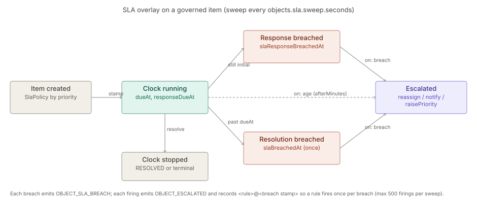

# Workflow and SLA

> **Level 3 module page** (`SOLUTION-SUITE-DOCS-1`). Layer: Add-on.
> Offering: add-on `workflowSla` in `offerings/professional.toon` — `status: planned`, `hostedBy[1]: engine`.
> The models are built (`ASSURE-WORKFLOW-SLA-1`, closed 2026-10-04); see §9. Checked against the code on 2026-10-17.

## 1. What it is

Authored **workflows** (the states and actions an Incident or Case may take), **SLA Policies** (response and
resolution targets per priority, on a business calendar) and **Escalation Rules** (what happens on a breach
or at an age). The pure models live in `platform/inspecto-workflow` (module id `workflow`, "Workflow and SLA
models", `offeringRole: base`); the runtime sweep lives in `features/inspecto-ops`.

- `platform/inspecto-workflow/src/main/java/com/gamma/workflow/Workflow.java` — definition, built-ins, validation, `apply`.
- `platform/inspecto-workflow/src/main/java/com/gamma/workflow/SlaPolicy.java` — targets + calendar (`addWorkingMinutes`).
- `platform/inspecto-workflow/src/main/java/com/gamma/workflow/EscalationRule.java` — trigger `BREACH` | `AGE`, priority ladder `LOW < MINOR < MAJOR < CRITICAL`.
- `platform/inspecto-workflow/src/main/java/com/gamma/workflow/SlaDecisions.java` — deadline and breach decisions.

## 2. Who uses it

- **Administrators** (`canAdminister`) author workflows, SLA Policies and Escalation Rules.
- **Incident and case handlers** see SLA badges (Respond by / Due / breached) and receive escalations.

## 3. Where it sits

The models are platform base; they are applied to `INCIDENT` and `CASE` objects by `ObjectService` in
`features/inspecto-ops` (`sweepIncidentSla`), with authored files loaded by `GovernanceRegistry`. Without
`inspecto-ops` there are no objects to govern and `GET /workflows/{type}` answers 503. See
[incidents](incidents.md) and [case-management](case-management.md).

## 4. How it works

- **Workflow** — built-ins from `Workflow.defaultFor`: INCIDENT `IDENTIFIED → DIAGNOSING → RESOLVED → ARCHIVED`
  (with `reopen`), CASE `OPEN → INVESTIGATING → ESCALATED → RESOLVED → CLOSED`, TASK `OPEN → CLOSED`. An authored
  workflow must pass `problems()`: a terminal state, every state reachable, a finishing way out of every
  non-terminal state, no duplicate action from one state, and for an Incident `RESOLVED` present with only
  `RESOLVED` moving into a terminal state other than `ARCHIVED`.
- **SLA clock** — on creation `dueAt` / `responseDueAt` are stamped from `createdAt` using the policy for the
  item's priority (`*` fallback; severity when priority is missing). A response breach is the response
  deadline passing while the item is still in its initial state; a resolution breach stamps `slaBreachedAt`
  once. Each breach emits `OBJECT_SLA_BREACH`. The clock stops at `RESOLVED` and at terminal states.
- **Escalation** — a rule fires on a breach (`target` resolution or response) or on age (`afterMinutes`),
  optionally filtered by `priority` and a `when` condition, and runs `reassign`, `notify` and/or
  `raisePriority`. It records `<rule>@<breach stamp>` in `attributes.escalations`, so it fires once per breach,
  sets `escalated=true` and emits `OBJECT_ESCALATED`. At most 500 firings per sweep.

## 5. Configuration

| Item | Where |
|---|---|
| Component kinds `workflow`, `sla-policy`, `escalation-rule` | `ComponentStore`; directories `registry/workflows/`, `registry/sla-policies/`, `registry/escalation-rules/` |
| Legacy override | a `*_workflow.toon` file (below an authored component, above the built-in) |
| SLA keys | `responseMinutes`, `resolutionMinutes` per priority or `*`; calendar working days, `start`, `end`, holidays, IANA zone (required) |
| Escalation keys | `on` (`breach` \| `age`), `target` (`resolution` \| `response`), `afterMinutes`, `priority`, `when`, actions `reassign` / `notify` / `raisePriority` |
| Sweep cadence | JVM property `-Dobjects.sla.sweep.seconds` (default 60; 0 disables) |

`GovernanceRegistry` re-reads the directories on change, loads at most 50 Escalation Rules, and keeps the
last valid version of a broken file. See [toon-config](../../okf/backend/config/toon-config.md).

## 6. Screens

Settings → Incident governance:

- `inspecto-ui/src/app/modules/admin/settings/incident-governance.component.ts` — policies, rules, workflows;
- `inspecto-ui/src/app/modules/admin/settings/workflow-diagram.component.ts` — graphical state-diagram editor;
- `inspecto-ui/src/app/modules/admin/settings/workflow-state-editor.component.ts`;
- SLA badges in the inbox from `slaBadges()` in `inspecto-ui/src/app/modules/admin/objects/mail-model.ts`.

## 7. API

| Route | Gate | Handler |
|---|---|---|
| `GET /workflows/{type}` | — | `features/inspecto-ops/src/main/java/com/gamma/opsapi/ObjectRoutes.java` |
| `POST /components/{kind}`, `PUT` / `DELETE /components/{kind}/{id}` (kind `workflow`, `sla-policy`, `escalation-rule`) | `canAdminister` | `inspecto/src/main/java/com/gamma/control/ComponentRoutes.java` |
| `POST /components/{kind}/{id}/versions/{v}/restore` | `canAdminister` | same |

`{kind}` is `workflow`, `sla-policy` or `escalation-rule`. A write that would strand live objects in a
removed state answers 409.

## 8. Interactions

- [maker-checker](maker-checker.md) — all three kinds are governable; a held write reads "submitted for
  approval". Imports refuse them.
- [notifications](notifications.md) — a `notify` escalation emits a warning `OBJECT_ESCALATED` event that the
  `builtin-escalation` rule in `NotificationRules` delivers.
- [identity-access](identity-access.md) — `reassign` targets are checked at save time (id shape only; no
  directory implementation ships).
- [jobs-scheduler](jobs-scheduler.md) — not used: the sweep is a timed cadence, not a Job Type.

## 9. Limits and gotchas

- The offering lists `workflowSla` as `planned` and hosted by the engine, while the code is built and the
  runtime lives in `ops`. The offering entry looks stale.
- A Case's `targetDate` is only a loose hint; the SLA Policy is the clock.
- Open residual `ASSURE-WORKFLOW-SLA-RESIDUALS-1` (a): a deleted assignee is not rechecked at sweep time.
- Queues and watchers were retired (INC-4); assignment is person-only.
