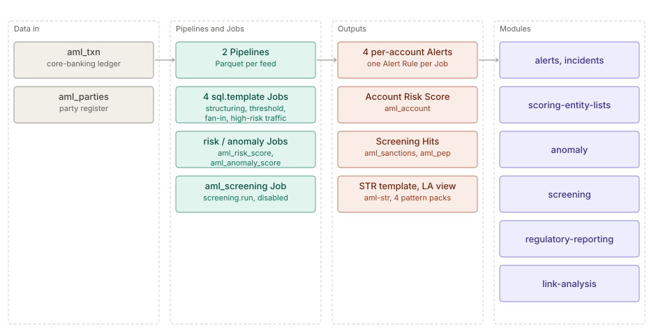

# Anti-money-laundering (AML)

> **Level 2 solution page** (`SOLUTION-SUITE-DOCS-1`). Content pack: Space Template `aml`
> (`spaces/_templates/aml/template.toon`). Offering: Standard and above (`offerings/standard.toon`,
> `contentPacks`). Checked against the template on 2026-10-17.

## Business problem

A bank or payment institution must detect laundering typologies in its transaction ledger, screen its
customers against sanctions and politically-exposed-person lists, rank accounts by risk, investigate
money trails, and file suspicious transaction reports (STRs). Doing that with separate tools loses the
link between a typology hit, the account's risk, the network around it and the report.

## Data in

Two synthetic feeds, each a Pipeline with a Schema under `spaces/_templates/aml/config/`:

| Feed (Pipeline) | Contents |
|---|---|
| `aml_txn` | core-banking account ledger: cash deposits, transfers, wires (payer, payee, country) |
| `aml_parties` | party register: names, national ids (a Reference for screening) |

The corpus ships in `data/samples`; copy each feed into `data/inbox/<feed>` to ingest.

## What the pack sets up

- **Four detection Jobs** (`sql.template`, daily 03:00, previous day plus a look-back window;
  `spaces/_templates/aml/config/jobs/`):
  `aml_structuring` (repeated cash deposits just under the reporting limit), `aml_threshold` (a day's
  cash over the limit), `aml_fan_in` (smurfing: many distinct payers into one account) and
  `aml_high_risk_traffic` (wires to a configured high-risk jurisdiction list).
- **Four per-account Alert Rules**, all CRITICAL, keyed on `account_id`
  (`spaces/_templates/aml/config/registry/alert-rules/`): e.g. `aml_fan_in` fires when `max(payers)` > 9,
  `aml_threshold` when `max(cash_total)` > 10 000.
- **Account Risk Score** `aml_account` with factors structuring, smurfing and high-risk wires, computed by
  `aml_risk_score` (`risk.score`, 04:30). Pending Alert Rule `aml_high_risk_account` (score ≥ 60).
- **Anomaly Model** `aml_account_transfers` (each account's daily outgoing transfer and wire count and
  value against its own history), scored by `aml_anomaly_score` (04:45). Pending Alert Rule
  `aml_unusual_account_transfers` (score ≥ 80).
- **Screening Job** `aml_screening` (`screening.run`, 05:00, `threshold: "0.85"`) over `aml_parties`
  against the Entity Lists `aml_sanctions` and `aml_pep`; ships `enabled: false`
  (`spaces/_templates/aml/config/jobs/aml_screening_job.toon`).
- **Link Analysis starters** — the saved view `aml_account_transfers` and four money pattern packs:
  `circular-flow`, `inbound-collector`, `layering-chain`, `pass-through`
  (`spaces/_templates/aml/config/registry/pattern-packs/`).
- **Report Template** `aml-str` — illustrative XML STR (17 fields), delivered as a file drop to
  `regulatory-submissions/aml-str` (`spaces/_templates/aml/config/regulatory-report-templates/aml-str.toon`).
- **Three KPIs** (cash over limit, high-risk amount, inbound small transfers), Widgets and the
  `aml_overview` dashboard; runbooks in `spaces/_templates/aml/config/runbooks/aml-runbooks.md`.

## Day in the life of an analyst

1. Before first use an administrator creates the `aml_sanctions` and `aml_pep` Entity Lists and enables
   `aml_screening`.
2. Each morning the analyst sees typology Alerts from the 03:00 run, risk-ranked accounts from 04:30,
   and Screening Hits from 05:00.
3. For a fan-in Alert the analyst opens `aml_account_transfers` in Link Analysis seeded with the account,
   runs the `inbound-collector` or `layering-chain` pattern pack and follows the money.
4. If the case is reportable, the analyst drafts an STR from the `aml-str` Report Template, which pulls
   the subject account, the Incidents and the narrative.
5. After the first scoring runs the analyst creates the two pending Alert Rules.

## Modules used

- [Pipelines and Steps](../modules/pipelines-steps.md),
  [Jobs and scheduler](../modules/jobs-scheduler.md).
- [Alerts](../modules/alerts.md), [Incidents](../modules/incidents.md),
  [Case management](../modules/case-management.md).
- [Scoring and Entity Lists](../modules/scoring-entity-lists.md).
- [Anomaly](../modules/anomaly.md).
- [Screening](../modules/screening.md).
- [Regulatory reporting](../modules/regulatory-reporting.md).
- [Link Analysis](../modules/link-analysis.md).
- [Studio BI](../modules/studio-bi.md).

## Diagram

## Limits

- The STR template follows no real regulator's schema; replace its fields and delivery directory.
- Entity Lists are not shipped; screening does nothing until they exist and the Job is enabled.
- Detection is daily batch over the previous day.
- The Link Analysis view needs the Link Analysis add-on modules (`offerings/basic.toon`,
  `addons.linkAnalysis`; Standard inherits it).
