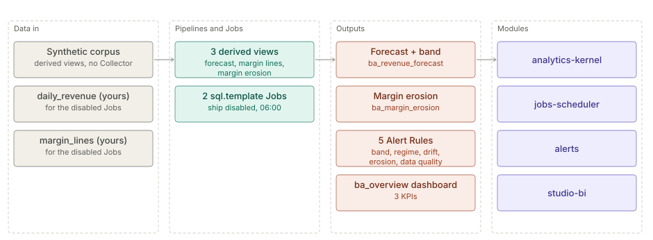

# Business assurance

> **Level 2 solution page** (`SOLUTION-SUITE-DOCS-1`). Content pack: Space Template `business-assurance`
> (`spaces/_templates/business-assurance/template.toon`). Offering: listed in `offerings/personal.toon`
> `contentPacks`, so in every edition. Checked against the template on 2026-10-17.

## Business problem

Finance and commercial teams want to know early when revenue leaves its normal seasonal range, when the
trend itself shifts, and which product, channel and partner combination is losing margin — without a
data-science project. The pack does both with plain DuckDB SQL and Alert Rules.

## Data in

The pack ships **no Collector or Pipeline**. It brings:

- A deterministic synthetic corpus: 26 weeks of daily revenue and 8 weeks of sales lines across 4
  products, 3 channels and 3 partners. It is generated inside three derived views in
  `spaces/_templates/business-assurance/config/views/` (`ba_revenue_forecast_view.toon`,
  `ba_margin_lines_view.toon`, `ba_margin_erosion_view.toon`), with planted anomalies (a revenue dip, a
  regime shift, an eroding P3 / online / PB line).
- Seed Parquet for the two Datasets the Alert Rules read: `data/revenue_forecast/seed.parquet` and
  `data/margin_erosion/seed.parquet` in the template folder.
- For your own data: two Jobs that expect stores named `daily_revenue` (columns `ds`, `revenue`) and
  `margin_lines` (product, channel, partner, units, revenue, cost).

## What the pack sets up

- **Revenue forecast** — a Holt-Winters additive model with a weekly season, written in SQL: forecast,
  lower and upper band (4 robust sigma), and flags `outside_band`, `regime_change`, `drift_change` per
  day after a 28-day warm-up (`ba_revenue_forecast_view.toon`).
- **Margin erosion** — baseline versus recent 28-day margin per product × channel × partner, with a
  status (`assessed`, `insufficient`, `new`, `data_quality`) and `erosion_pp`
  (`ba_margin_erosion_view.toon`).
- **Two Jobs** `ba_revenue_forecast` and `ba_margin_erosion` (`sql.template`, 06:00) that run the same
  SQL over `daily_revenue` / `margin_lines` into `revenue_forecast` / `margin_erosion`; both ship
  `enabled: false` (`spaces/_templates/business-assurance/config/jobs/`).
- **Five Alert Rules** (`spaces/_templates/business-assurance/config/registry/alert-rules/`):
  `ba_revenue_outside_band`, `ba_revenue_regime_change`, `ba_revenue_drift` (CRITICAL, by `ds`),
  `ba_margin_erosion` (WARNING, `max(erosion_pp)` > 5) and `ba_margin_data_quality` (WARNING).
- **Three KPIs** (`ba_revenue`, `ba_margin`, `ba_days_outside_band`), five Widgets including
  `ba_revenue_vs_forecast` and `ba_margin_erosion_by_partner`, and the `ba_overview` dashboard.
- **Runbooks** — `spaces/_templates/business-assurance/config/runbooks/business-assurance-runbooks.md`.

## Day in the life of an analyst

1. On the synthetic corpus the dashboard is populated immediately from the seed Datasets.
2. With real data, the analyst lands `daily_revenue` and `margin_lines` and enables the two Jobs.
3. Each morning `ba_overview` shows revenue against forecast with the band, and days outside it.
4. A `ba_revenue_outside_band` Alert on one day is checked against the calendar (holiday, outage); a
   `ba_revenue_regime_change` means the new level is real and the forecast re-anchors.
5. A `ba_margin_erosion` Alert names the product, channel and partner; the analyst takes it to pricing or
   partner management. A `data_quality` status means fix the feed first.

## Modules used

- [Analytics kernel](../modules/analytics-kernel.md) — SQL views and Datasets.
- [Jobs and scheduler](../modules/jobs-scheduler.md).
- [Alerts](../modules/alerts.md), [Incidents](../modules/incidents.md).
- [Studio BI](../modules/studio-bi.md).

## Diagram

## Limits

- No ingest is configured; you must provide `daily_revenue` and `margin_lines` yourself.
- Model parameters (smoothing constants, band width, warm-up, minimum lines and revenue) are literals
  inside the SQL, not separate configuration keys.
- One weekly season only; no holiday calendar.
- The margin model compares two fixed 28-day windows.
