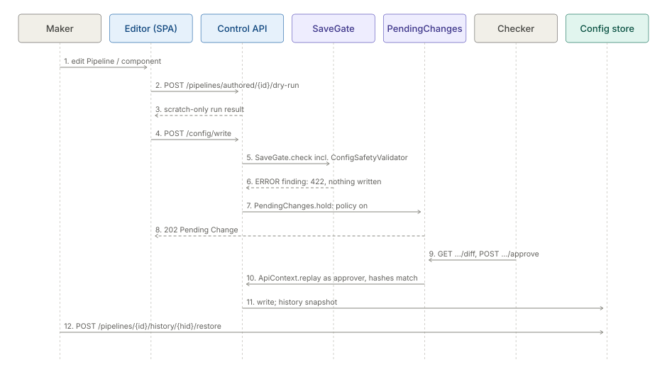

# Journey: a safe config change

## Purpose

Show how a change to a Pipeline or component reaches production without surprises: authoring, a dry run,
the one save gate (`SaveGate`, which includes `ConfigSafetyValidator`), maker-checker Pending Changes, and
config history with restore.

## Actors

| Actor | Does |
|---|---|
| Maker | Authors the change (`canAuthorWorkbench`) |
| Checker | Reviews the diff and approves or declines (`canApproveChanges`) |
| Administrator | Sets the Space's approval policy (`PUT /api/v1/settings/approval`, `canAdminister`) |
| Operator | Fires a dry-run Run of the Job (`canOperateRuns`) |

## Walkthrough

1. **Author.** The maker edits in the Pipeline editor (route `pipelines`) or a component editor (route
   `components`, or Studio). `GET /api/v1/config/spec/{type}` supplies the form schema;
   `GET /api/v1/config/pipeline/{pipelineId}/impact` shows what depends on the Pipeline.
2. **Dry run in the editor.** The dry-run panel
   (`inspecto-ui/src/app/modules/admin/pipelines/pipeline-dry-run-panel.component.ts`) calls
   `POST /api/v1/pipelines/authored/{authoredId}/dry-run`: a bounded, scratch-only run over real inbox files
   that writes nothing outside a scratch root.
3. **Dry-run fire of the Job.** `POST /api/v1/jobs/{name}/trigger?dryRun=true` fires a preview Run that
   reports impact and mutates nothing; `DryRunServices` makes mutating Platform Services record the would-be
   effect to the RunLog instead of acting.
4. **Save and safety gate.** The editor saves through `POST /api/v1/config/write` or `POST /api/v1/config/patch`
   (graph save and import have their own routes). Every save path runs `SaveGate.check`, the single list of
   checks, which includes `ConfigSafetyValidator`: path jail under the allowed roots, numeric bounds (threads,
   batch caps, `retention_days` of at least 1 when duplicate-check is on) and the output allow-list. An ERROR
   finding refuses the save and nothing is written.
5. **Maker-checker hold.** After validation and before any side effect the route calls `PendingChanges.hold`.
   With the Space's approval policy off for that kind the write proceeds. With it on, the API answers `202`
   with a Pending Change and writes nothing. Only one change per target can be pending.
6. **Review.** The checker opens **Operations > Pending Changes** (route `pending-changes`):
   `GET /api/v1/pending-changes` and `GET /api/v1/pending-changes/{id}/diff`. The maker can
   `POST /api/v1/pending-changes/{id}/withdraw`.
7. **Approve.** `POST /api/v1/pending-changes/{id}/approve` replays the original request through the same route
   as the approver (`ApiContext.replay`). Every gate runs again; the write goes through only if the content it
   replaces still hashes to the base the maker saw and the new content hashes to what was approved, else `409`.
   `POST /api/v1/pending-changes/{id}/decline` refuses it.
8. **History.** Each successful Pipeline save calls `PipelineHistory.record`. The history dialog
   (`inspecto-ui/src/app/modules/admin/pipelines/pipeline-history.dialog.ts`) reads
   `GET /api/v1/pipelines/{pipelineId}/history`, `/history/{historyId}` and `/history/diff`. Retention is set via
   `GET` / `PUT /api/v1/settings/pipeline-history`. Components keep versions at
   `GET /api/v1/components/{kind}/{id}/versions`.
9. **Rollback.** `POST /api/v1/pipelines/{pipelineId}/history/{historyId}/restore` (components:
   `/components/{kind}/{id}/versions/{version}/restore`) restores an earlier version. A restore is itself a new
   version; history is never rewritten.

## Diagram

Script: `tools/doc-diagrams/journey-safe-config-change.py`.

## What can go wrong

- **Unsafe config.** A path outside the allowed roots, a UNC path or a `..` escape is an ERROR finding; the
  save fails closed whoever authored it, an AI draft included.
- **Different verdict per door.** Prevented by design: all save paths share `SaveGate`, and
  `ControlApiSaveGateParityTest` drives one fault through every door.
- **Stale approval.** If the target changed after the maker saw it, the approved replay answers `409`.
- **Competing changes.** A second change to a target that already has one pending is refused with `409`.
- **Dry run with side effects.** Mutating Platform Services are swapped for recording stand-ins; a service
  the Run did not declare stays invisible, dry run or not.
- **Policy unreadable.** `GET /api/v1/settings/approval` carries `failedClosed`; there is no dedicated policy
  screen in the SPA.

## Related modules

[maker-checker](../modules/maker-checker.md) ·
[pipelines-steps](../modules/pipelines-steps.md) ·
[jobs-scheduler](../modules/jobs-scheduler.md) ·
[platform-services](../modules/platform-services.md) ·
[identity-access](../modules/identity-access.md) ·
[spaces](../modules/spaces.md) ·
[observability-backup](../modules/observability-backup.md)

Concepts: [pipeline authoring](../../okf/capabilities/pipeline-authoring/pipeline-authoring.md) ·
[security](../../okf/capabilities/security/security.md)
