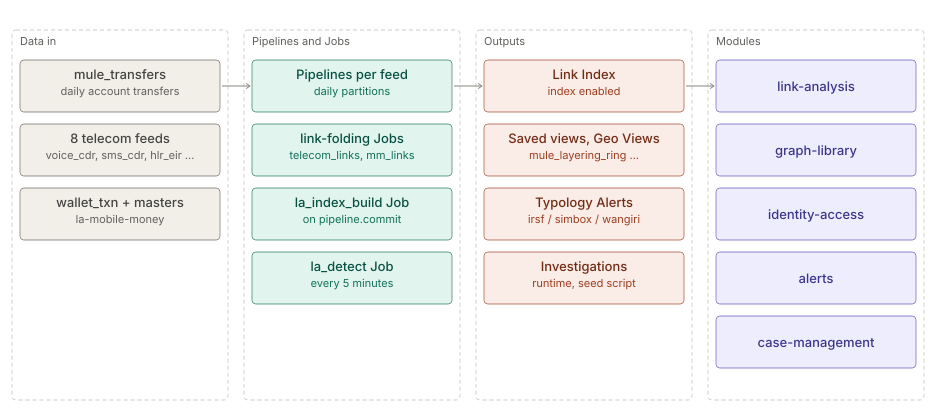

# Link Analysis

> **Level 2 solution page** (`SOLUTION-SUITE-DOCS-1`). Content: the Space Templates `la-showcase`
> (`spaces/_templates/la-showcase/template.toon`) and `la-mobile-money`
> (`spaces/_templates/la-mobile-money/template.toon`). Offering: the `linkAnalysis` add-on in
> `offerings/basic.toon` (modules `la-storage`, `la-core`, `la-api`, `geo-link`) and
> `offerings/advanced.toon` (`la-store-pg`). Checked against the templates on 2026-10-17.

## Business problem

Fraud and AML rings hide in relationships: smurfs feeding a mule hub, money circulating between shell
accounts, a cash-out till taking most of the proceeds, a SIM box several hops from a suspect. Row-level
alerts see each party alone. Investigators need a graph over transactions and telecom events, masked by
default, with a second approver for wide expansions and standing detection on what they found.

## Data in

`la-showcase` (`spaces/_templates/la-showcase/config/`):

| Pipeline | Contents |
|---|---|
| `mule_transfers` | daily synthetic account-to-account transfers (three landed days, plus staged next-day and gap-day files in `data/staged`) |
| `mule_account_locations`, `mule_geo_legs` | account cities and geocoded story legs for the Geo scene |
| `voice_cdr`, `sms_cdr`, `hlr_eir`, `crm_kyc`, `recharge`, `provisioning`, `fraud_blocklist`, `fraud_alarms` | eight 60-day telecom feeds (`config/telecom/`) |

`la-mobile-money` (`spaces/_templates/la-mobile-money/config/`): `wallet_txn` (daily, 14 landed days),
`wallet_master` and `agent_master` snapshots.

## What the pack sets up

- **Settings** — `spaces/_templates/la-showcase/config/link-analysis.toon`: `masking_mode: typed`,
  `four_eyes_fan_out_above: 2000`, `index.enabled: true`, Drafts limits (`max_open: 10`,
  `hibernate_after_minutes: 60`, `expire_after_days: 14`). The mobile-money template sets a fan-out
  threshold of 100 (`spaces/_templates/la-mobile-money/config/link-analysis.toon`). Both templates declare
  `minEdition: advanced`.
- **Index Job** `la_index_build` (`la.index.build`, `on_signal: pipeline.commit` for `mule_transfers`):
  first a full build, then appends (`spaces/_templates/la-showcase/config/jobs/la_index_build_job.toon`).
- **Standing detection** `la_detect` (`la.detect`, every 5 minutes) evaluates Alert Rules bound to an
  Investigation whose owner enabled standing detection.
- **Link-folding Jobs** — `telecom_links` and `telecom_msisdn_indicators` (`sql.template`, every 10
  minutes) fold the telecom feeds into one MSISDN-to-MSISDN link Dataset and a 0–100 indicator per MSISDN;
  `telecom_typology_counts` and `telecom_typology_alerts` (`alert.evaluate`) follow on
  `job.dataset.produced`. In `la-mobile-money`, `mm_links` folds wallets into one link Dataset (p2p,
  cash in/out, merchant pay, shared device, shared id).
- **Alert Rules** `telecom_irsf_lines`, `telecom_simbox_lines` (CRITICAL) and `telecom_wangiri_lines`
  (WARNING) over `telecom_typology_counts_dataset`.
- **Saved views** — `mule_large_transfers`, `mule_layering_ring`, `mule_structuring`,
  `telecom_fraud_network`; in mobile money `mm_device_farm`, `mm_money_trail`, `mm_structuring_band`.
- **Pattern packs** `telecom-forwarding-chain`, `telecom-payment-ring`, `telecom-subscription-ring`.
- **Geo Views** `mule_account_locations_map`, `mule_ring_route_map`, `mule_cashout_till_map`.
- **Demo Users and roles** — `roles.toon` and `demo-users.toon` (lead analyst, second approver,
  read-only reviewer, a non-member, an admin who can reveal masked values).

Investigations, members, Entity Lists, a Case and a bound Alert Rule are runtime state with no template
home; `tools/seed-la-showcase.mjs` and `tools/seed-la-mm.mjs` create them against a running server.

## Day in the life of an analyst

1. A new `mule_transfers` file commits; the index appends without anyone asking.
2. The lead analyst opens `mule_structuring`, seeds it with `MULE-HUB-01`, sees the twelve smurfs and
   runs cycle detection — the `SHELL-A`..`SHELL-D` loop is the only directed cycle.
3. Expanding the hub exceeds the four-eyes fan-out threshold, so the expansion waits for the second
   approver.
4. Identifiers stay masked; only the admin role can reveal.
5. The analyst saves the finding to an Investigation, binds a structuring Alert Rule and enables standing
   detection; `la_detect` then watches it every five minutes and a hit can go to a Case.

## Modules used

- [Link Analysis](../modules/link-analysis.md) — index, views, Investigations,
  four-eyes, masking, standing detection.
- [Graph library](../modules/graph-library.md) — cycles, paths, pattern packs.
- [Pipelines and Steps](../modules/pipelines-steps.md),
  [Jobs and scheduler](../modules/jobs-scheduler.md).
- [Identity and access](../modules/identity-access.md) — roles, reveal.
- [Maker-checker](../modules/maker-checker.md) — the second approver.
- [Alerts](../modules/alerts.md),
  [Case management](../modules/case-management.md).

## Diagram

## Limits

- Both templates are demos on synthetic data and need the Demo Auth build (`serve-demo`) for the Demo
  Users.
- Investigations and Entity Lists are not part of the template; the seed scripts must be run.
- `la-showcase` and `la-mobile-money` are not in any offering's `contentPacks` list; only
  `la-daily-feed` is (`offerings/basic.toon`).
- The AML pack ships its own Link Analysis starter view (see [AML](aml.md)).
