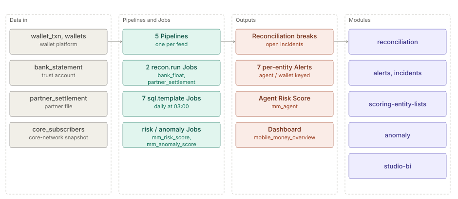

# Mobile money

> **Level 2 solution page** (`SOLUTION-SUITE-DOCS-1`). Content pack: Space Template `mobile-money`
> (`spaces/_templates/mobile-money/template.toon`). Offering: Professional and above
> (`offerings/standard.toon`, `contentPacks`). Checked against the template on 2026-10-17.

## Business problem

A mobile-money operator must prove that the e-money on the wallet platform is backed by the trust account
at the bank, that partner settlements match, that fees and agent commissions are charged correctly, and
that agents and wallets are not abused (split transactions under limits, round-tripping, dormant wallets
waking up, KYC tier breaches, wallets with no matching subscriber).

## Data in

Five synthetic feeds, each a Pipeline with a Schema under `spaces/_templates/mobile-money/config/`:

| Feed (Pipeline) | Contents |
|---|---|
| `wallet_txn` | wallet-platform ledger (cash-in/out, P2P, bank in/out, fees, commissions) |
| `wallets` | wallet register with KYC tier (a Reference) |
| `bank_statement` | trust-account bank statement |
| `partner_settlement` | partner settlement file |
| `core_subscribers` | core-network subscriber snapshots |

## What the pack sets up

- **Two Reconciliations** (`recon.run`, 04:00):
  `mm_bank_float` — wallet `BANK_OUT` / `BANK_IN` transactions against the bank statement, keyed on
  `txn_id` mapped to `bank_ref`, one-to-many, absolute tolerance 0.01
  (`spaces/_templates/mobile-money/config/registry/reconciliations/mm_bank_float.toon`); and
  `mm_partner_settlement`.
- **Seven detection Jobs** (`sql.template`, 03:00, previous day; `spaces/_templates/mobile-money/config/jobs/`):
  `mm_commission`, `mm_fee`, `mm_agent_split`, `mm_round_trip`, `mm_dormant`, `mm_kyc_limit`,
  `mm_provisioning`.
- **Seven per-entity Alert Rules** (`spaces/_templates/mobile-money/config/registry/alert-rules/`):
  by `agent_id` — `mm_agent_split` (CRITICAL, > 3 splits), `mm_round_trip` (CRITICAL),
  `mm_commission` (WARNING); by `wallet_id` — `mm_fee`, `mm_dormant`, `mm_kyc_limit`, `mm_provisioning`
  (WARNING).
- **Agent Risk Score** `mm_agent` (factors split, round trip, commission) via `mm_risk_score` (04:30);
  pending Alert Rule `mm_high_risk_agent` (score ≥ 60).
- **Anomaly Model** `mm_wallet_activity` (each wallet's daily count and value against its own history and
  its KYC-tier peers) via `mm_anomaly_score` (04:45); pending Alert Rule `mm_unusual_wallet_activity`
  (score ≥ 80).
- **Four KPIs** (commission variance, dormant outflow, fee overcharged, KYC excess), eleven Widgets, the
  `mobile_money_overview` dashboard and
  `spaces/_templates/mobile-money/config/runbooks/mobile-money-runbooks.md`.

## Day in the life of an analyst

1. At 03:00 the typology Jobs run over yesterday; at 04:00 the two Reconciliations; scores at 04:30 and
   04:45.
2. The analyst opens `mobile_money_overview`: overcharged fees, commission variance, dormant outflow,
   KYC excess.
3. A float break between the wallet ledger and the bank statement is worked first; the analyst drills into
   the unmatched `txn_id`s.
4. An agent with split transactions under the limit and a rising Risk Score goes to the agent-network
   team with the runbook.
5. Wallet-level WARNINGs (fee mis-charge, provisioning mismatch) are batched to operations.

## Modules used

- [Pipelines and Steps](../modules/pipelines-steps.md),
  [Jobs and scheduler](../modules/jobs-scheduler.md).
- [Reconciliation](../modules/reconciliation.md).
- [Alerts](../modules/alerts.md), [Incidents](../modules/incidents.md).
- [Scoring and Entity Lists](../modules/scoring-entity-lists.md).
- [Anomaly](../modules/anomaly.md).
- [Studio BI](../modules/studio-bi.md).
- For network investigation of wallets and agents see the separate `la-mobile-money` template on the
  [Link Analysis solution page](link-analysis.md).

## Diagram

## Limits

- All rates, limits and thresholds are illustrative configuration tuned to the synthetic corpus.
- Detection and reconciliation are daily batch.
- The two score-based Alert Rules must be created by hand after the first scoring run.
- This pack carries no Link Analysis view; `la-mobile-money` is a separate demo template.
