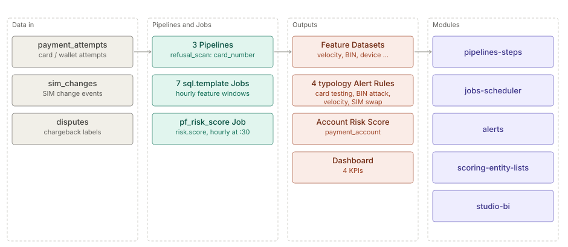

# Payment fraud

> **Level 2 solution page** (`SOLUTION-SUITE-DOCS-1`). Content pack: Space Template `payment-fraud`
> (`spaces/_templates/payment-fraud/template.toon`, "slice 1"). Checked against the template on 2026-10-17.

## Business problem

Card and wallet payment fraud shows up as patterns across many small events: one device trying many
cards for small amounts (card testing), many cards from one BIN being declined (BIN attack), bursts of
attempts on one instrument, and payments from a new device right after a SIM change (account takeover).
A fraud team needs rolling-window features over the attempts, an alert per offending entity, a combined
account risk view, and dispute outcomes as labels — without letting raw card numbers into the store.

## Data in

Three synthetic feeds, each a Pipeline with a Schema under `spaces/_templates/payment-fraud/config/`:

| Feed (Pipeline) | Contents |
|---|---|
| `payment_attempts` | attempts per account, instrument token, device, BIN, amount, outcome |
| `sim_changes` | SIM change events per account |
| `disputes` | chargebacks / disputes against attempt ids |

Every Pipeline sets `refusal_scan: card_number` with `refusal: restricted_quarantine`
(`spaces/_templates/payment-fraud/config/payment_attempts/payment_attempts_pipeline.toon`): a file that
carries a Luhn-valid, card-shaped number is moved to the restricted quarantine (retained 30 days) instead
of being ingested. Gap detection watches the daily file sequence.

## What the pack sets up

- **Seven feature Jobs** (`sql.template`, hourly at :00, `spaces/_templates/payment-fraud/config/jobs/`),
  each writing a Dataset of the same name: `pf_account_activity`, `pf_attempt_labels`,
  `pf_bin_declines`, `pf_daily_summary`, `pf_device_small_amounts`, `pf_instrument_velocity`,
  `pf_sim_swap_payments`. Each ships as a zero-row schema seed that the first run replaces.
- **Dispute labels** — `pf_attempt_labels` marks each attempt `DISPUTED`, `NEGATIVE` or `UNMATURED`
  using `maturity_days: "120"`.
- **Four per-entity Alert Rules**, all CRITICAL
  (`spaces/_templates/payment-fraud/config/registry/alert-rules/`): `pf_card_testing` by `device_id`,
  `pf_bin_attack` by `bin`, `pf_velocity_burst` by `instrument_token`, `pf_sim_swap_takeover` by
  `account_id`.
- **Risk Score** `payment_account` (`entityType: account`, `highThreshold: 60`) with four factors —
  SIM-swap payments, velocity, declines, disputes
  (`spaces/_templates/payment-fraud/config/registry/risk-scores/payment_account.toon`), computed by
  `pf_risk_score` (`risk.score`, hourly at :30).
- **Pending Alert Rule** `pf_high_risk_account` (score ≥ 60) in `config/pending/`, created after the
  first Risk Score run.
- **Four KPIs** (attempted amount, declined attempts, disputed amount, disputes opened), nine Widgets and
  the `payment_fraud_overview` dashboard.
- **Runbooks** — `spaces/_templates/payment-fraud/config/runbooks/payment-fraud-runbooks.md`.

## Day in the life of an analyst

1. Files arrive through the day; any with a card number is moved to the restricted quarantine
   instead of being ingested.
2. Each hour the features refresh and the Risk Score recomputes half an hour later.
3. The analyst triages Alerts: a device that tried eight or more cards for small amounts, a BIN with
   fifteen or more declined instruments.
4. For a SIM-swap takeover the analyst checks the account's Risk Score factors, then works the Incident
   from the runbook.
5. Matured dispute labels show which past alerts were real, which informs threshold changes.

## Modules used

- [Pipelines and Steps](../modules/pipelines-steps.md),
  [Parsing and ingest](../modules/parsing-ingest.md) — the card-number refusal scan.
- [Storage](../modules/storage.md) — restricted quarantine.
- [Jobs and scheduler](../modules/jobs-scheduler.md).
- [Alerts](../modules/alerts.md), [Incidents](../modules/incidents.md).
- [Scoring and Entity Lists](../modules/scoring-entity-lists.md) — the Risk Score.
- [Studio BI](../modules/studio-bi.md).

## Diagram

## Limits

- The scan misses a card number split across two cells, glued to other digits or in a layout other than
  the listed groupings (stated in `template.toon`).
- The template's `contents` says "7 feature Datasets" while its description says "five"; the folder has
  seven feature Jobs (plus `pf_risk_score_job`) and ten Dataset records (the seven plus `payment_attempts`, `disputes`, `sim_changes`).
- The Risk Score needs Scoring & Lists (Professional and above), but `offerings/personal.toon` lists
  `payment-fraud` as a Personal pack.
- Features are hourly batch, not authorisation-time scoring.
