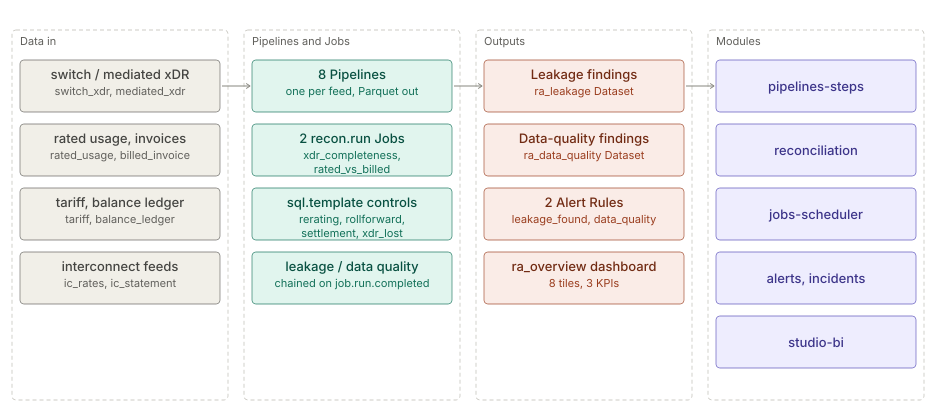

# Revenue assurance (telecom)

> **Level 2 solution page** (`SOLUTION-SUITE-DOCS-1`). Content pack: Space Template `telco-ra`
> (`spaces/_templates/telco-ra/template.toon`). Checked against the template on 2026-10-17.

## Business problem

Usage that the network carried but nobody billed, billed at the wrong rate, or settled wrongly with an
interconnect partner is revenue lost silently. A revenue-assurance team needs repeatable controls that
compare every hand-off (switch to mediation to rating to billing, prepaid balances, partner statements),
quantify the gap and track each finding until it is confirmed and recovered.

## Data in

Eight synthetic feeds, each with its own Pipeline and Schema under `spaces/_templates/telco-ra/config/`:

| Feed (Pipeline) | Role |
|---|---|
| `switch_xdr` | xDRs as the switch produced them |
| `mediated_xdr` | xDRs after mediation |
| `rated_usage` | rated xDRs with a charge |
| `billed_invoice` | invoice lines per subscriber |
| `tariff` | effective-dated tariff table (a Reference) |
| `balance_ledger` | prepaid balance movements |
| `ic_rates` | interconnect rates (a Reference) |
| `ic_statement` | partner interconnect statements |

Each Pipeline polls `data/inbox/<feed>` and writes Parquet
(`spaces/_templates/telco-ra/config/switch_xdr/switch_xdr_pipeline.toon`). The synthetic golden corpus
(fixed seed, planted leakages and benign look-alikes) ships in `data/samples`; copy a feed into
`data/inbox/<feed>` to ingest it.

## What the pack sets up

- **Two Reconciliations** — `ra_xdr_completeness` (switch / mediation / rating 3-way) and
  `ra_rated_vs_billed` (monthly rated charge against the invoice, keyed on `SUBSCRIBER_ID`, absolute
  tolerance 0.05; `spaces/_templates/telco-ra/config/registry/reconciliations/ra_rated_vs_billed.toon`).
  Both run as `recon.run` Jobs at 05:00 and 05:05.
- **Control Jobs** (`spaces/_templates/telco-ra/config/jobs/`), all `sql.template`:
  `ra_xdr_lost` (05:02), `ra_rerating` against the tariff (05:10), then `ra_rollforward`
  (opening + in − out = closing) and `ra_settlement`, chained with `on_signal: job.run.completed`.
  `ra_leakage` and `ra_data_quality` fold the findings into two Datasets once `ra_settlement` succeeds.
  `ra_recovery` runs hourly; `ra_objects_analytics` (`objects.analytics`) hourly.
- **A completeness tile** fed by `ra_switch_kpi_completeness` (`kpi.completeness`, ships `enabled: false`).
- **Two Alert Rules** — `ra_leakage_found` (CRITICAL, count by `CONTROL` ≥ 1) and `ra_data_quality`
  (WARNING), in `spaces/_templates/telco-ra/config/registry/alert-rules/`.
- **Two Expectations** — `ra_rated_charge_non_negative`, `ra_switch_xdr_id_non_null`.
- **Three KPIs** — `leakage_found`, `leakage_items`, `data_quality_items`.
- **Dashboard** `ra_overview` with eight tiles: leakage found / items / confirmed / recovered, xDR lost,
  data-quality items, leakage by control, completeness status
  (`spaces/_templates/telco-ra/config/registry/dashboards/ra_overview.toon`).
- **Runbooks** — `spaces/_templates/telco-ra/config/runbooks/telco-ra-runbooks.md`.

Every tolerance and threshold is configuration in these files.

## Day in the life of an analyst

1. Overnight the feeds land; the two Reconciliations run at 05:00, the re-rating, roll-forward and
   settlement controls follow in a chain.
2. At the start of the day the analyst opens `ra_overview`: leakage found per control, xDRs lost, and the
   data-quality count.
3. A `ra_leakage_found` Alert per control opens an Incident; a Reconciliation breach opens one too. The
   analyst works it from the runbook, confirms or dismisses the finding and records the Disposition.
4. Confirmed items feed the impact ledger; `ra_recovery` refreshes the recovered amount hourly, which
   shows on the "leakage recovered" tile.
5. Data-quality findings (for example a negative rated charge) go back to the feed owner rather than
   being counted as leakage.

## Modules used

- [Pipelines and Steps](../modules/pipelines-steps.md) — the eight feeds.
- [Collectors](../modules/collectors.md) and
  [Parsing and ingest](../modules/parsing-ingest.md) — inbox polling and Schemas.
- [Reconciliation](../modules/reconciliation.md) — the two `recon.run` controls.
- [Jobs and scheduler](../modules/jobs-scheduler.md) — cron and signal chaining.
- [Alerts](../modules/alerts.md) and [Incidents](../modules/incidents.md).
- [Studio BI](../modules/studio-bi.md) — KPIs, Widgets, the dashboard.
- [Platform services](../modules/platform-services.md) — `objects.analytics`.

## Diagram

## Limits

- The corpus is synthetic and the Schemas are canonical; a real operator maps its own switch, mediation
  and billing extracts onto them.
- The completeness tile is empty until `ra_switch_kpi_completeness` is enabled.
- The template says it needs the Professional or Enterprise edition, yet `offerings/personal.toon` lists
  `telco-ra` among Personal content packs — the two disagree; treat Professional as the safe requirement.
- `contents` in `template.toon` says "4 control Jobs"; the folder holds eleven Jobs (including the two
  `recon.run`, the fold-up and recovery Jobs).
