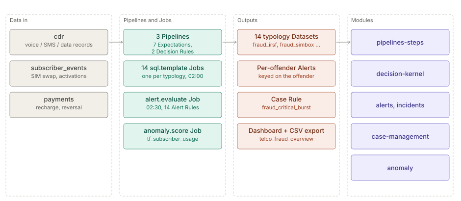

# Telecom fraud

> **Level 2 solution page** (`SOLUTION-SUITE-DOCS-1`). Content pack: Space Template `telco-fraud`
> (`spaces/_templates/telco-fraud/template.toon`). Checked against the template on 2026-10-17.

## Business problem

A mobile operator loses money to a long tail of fraud typologies — international revenue share fraud
(IRSF), Wangiri callbacks, SIM boxes, premium-rate abuse, SIM-swap takeovers, dealer and internal fraud.
Each needs its own detection window, an offender-level alert, and a desk that can group related Incidents
and follow a runbook.

## Data in

Three synthetic feeds, each a Pipeline with a Schema under `spaces/_templates/telco-fraud/config/`:

| Feed (Pipeline) | Contents |
|---|---|
| `cdr` | voice, SMS and data call detail records (roaming flag, service, duration) |
| `subscriber_events` | SIM swaps, activations, identity documents, dealer and staff actions |
| `payments` | recharges, vouchers, reversals, manual adjustments |

The golden corpus ships in `data/samples`; copy it into `data/inbox/<feed>` to ingest.

## What the pack sets up

- **Seven Expectations** on the feeds, e.g. `tf_cdr_duration_in_range`, `tf_payments_amount_in_range`
  (`spaces/_templates/telco-fraud/config/registry/expectations/`), evaluated by the
  `fraud_expectation_evaluate` Job at 01:45.
- **Two Decision Rules** that act on rows as they pass the Pipeline
  (`spaces/_templates/telco-fraud/config/registry/decision-rules/`):
  `tf_long_roaming_call_escalate` (roaming voice call over 7 200 s → `create-incident`) on `cdr`, and
  `tf_reversal_route_by_typology` (reversal → tag `fraud_reversal`) on `payments`.
- **Fourteen detection Jobs** (`sql.template`, 02:00 daily) — adjustment, data bypass, dealer, identity,
  internal, IRSF, premium rate, recharge, reversal, roaming, SIM box, SIM swap, voucher, Wangiri — each
  writing a Dataset of the same name (`spaces/_templates/telco-fraud/config/jobs/`).
- **Fourteen per-entity Alert Rules** keyed on the offender (`msisdn`, `caller`, `agent_id`, `dealer_id`,
  `staff_id`, `id_doc`, `voucher_serial`), CRITICAL or WARNING, each linked to its runbook record in
  `registry/runbooks/`. Example: `fraud_irsf` fires when `max(irsf_seconds)` > 3 600 per `msisdn`
  (`spaces/_templates/telco-fraud/config/registry/alert-rules/fraud_irsf.toon`). The
  `fraud_alert_evaluate` Job (`alert.evaluate`) runs them at 02:30.
- **A Case Rule** `fraud_critical_burst` that groups CRITICAL Incidents on one `msisdn` within 24 h into
  a Case (`spaces/_templates/telco-fraud/config/ops/fraud_critical_burst_caserule.toon`).
- **A subscriber-usage Anomaly Model** `tf_subscriber_usage` scored by `tf_anomaly_score` (04:45); its
  Alert Rule `tf_unusual_subscriber_usage` sits in `config/pending/` and is created after the model's
  first run.
- **Nightly offender export** — `fraud_offender_export` (`report` Job, 03:00) writes the IRSF offenders
  as CSV.
- **Four KPIs** (IRSF exposure seconds, premium-rate exposure, reversed amount, roaming exposure), 18
  Widgets and the `telco_fraud_overview` dashboard.

## Day in the life of an analyst

1. Overnight: Expectations check the feeds, the fourteen windows run, Alert Rules evaluate, the offender
   export lands.
2. The analyst opens the fraud desk: Alerts per offender, plus any Case that `fraud_critical_burst`
   opened because one line hit several CRITICAL typologies.
3. For a SIM-box line the analyst opens the runbook from the Alert, checks the `fraud_simbox_by_line`
   Widget, and records a Disposition on the Incident.
4. A roaming call over two hours already opened its own Incident during ingest through the Decision Rule.
5. After the Anomaly Model's first run the analyst creates the pending unusual-usage Alert Rule.

## Modules used

- [Pipelines and Steps](../modules/pipelines-steps.md),
  [Collectors](../modules/collectors.md).
- [Decision kernel](../modules/decision-kernel.md) — the two Decision Rules.
- [Jobs and scheduler](../modules/jobs-scheduler.md).
- [Alerts](../modules/alerts.md), [Incidents](../modules/incidents.md).
- [Case management](../modules/case-management.md) — the Case Rule.
- [Anomaly](../modules/anomaly.md) — the subscriber-usage model.
- [Studio BI](../modules/studio-bi.md).

## Diagram

## Limits

- Detection is daily batch (02:00), not real-time; only the Decision Rules act at ingest.
- The Anomaly Model part needs Professional or Enterprise with Anomaly Detection; `offerings/personal.toon`
  lists `telco-fraud` as a Personal pack, so on Personal the anomaly Job has no module to run it.
- Thresholds are illustrative values tuned to the synthetic corpus.
- The pending Alert Rule must be created by hand after the first scoring run.
